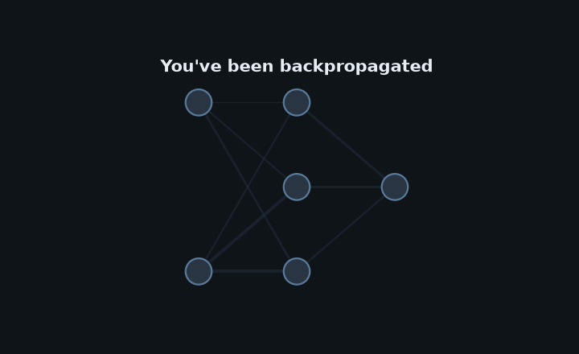

  

## About me

AI / Software Engineer with 5+ years building production ML and GenAI systems. Strong in LLMs, RAG, NLP, and AI automation (Python, FastAPI, GCP).

Currently Platform AI Engineer at TELUS Digital, working on System One model development and integrating those models into systems to reduce cost — alongside retrieval pipelines, LLM workflows, and governed production features.

Based in Belo Horizonte, Brazil · open to remote.

## How to reach me

- LinkedIn: [linkedin.com/in/eduardojddsm](https://www.linkedin.com/in/eduardojddsm/)
- Email: [edjusantos@gmail.com](mailto:edjusantos@gmail.com)
